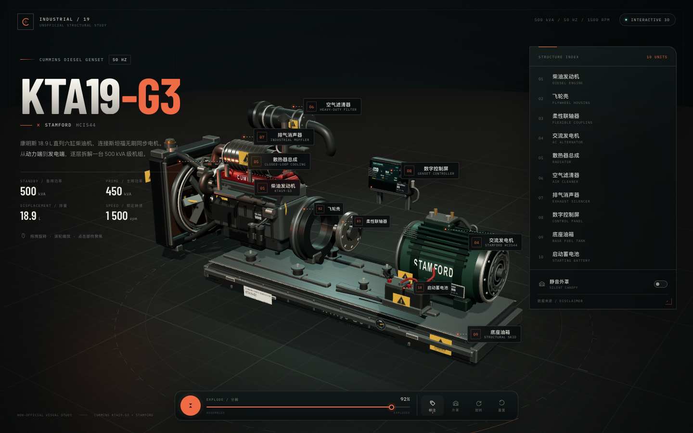

# KTA19-G3 × STAMFORD · 交互式爆炸图

> Cummins KTA19-G3 柴油发电机组 / Stamford HCI544 交流电机的 Three.js 产品分解演示。  
> 单文件、离线可开、全部几何与纹理程序化生成。

**在线预览（GitHub Pages）**：<https://davidz84608406-arch.github.io/kta19-g3-exploded/>



## 打开方式

直接双击 **`index.html`** 即可。页面是自包含的（Three.js、字体、程序化纹理全部内联），不依赖网络、图片或外部 3D 模型；需要支持 WebGL2 的现代浏览器。

如果浏览器限制本地文件，可以用任意静态服务器：

```bash
python3 -m http.server 4173
# 打开 http://127.0.0.1:4173/index.html
```

## 交互

- **拖动**旋转视角，**滚轮 / 双指**缩放；右上角索引和 3D 标注可点击聚焦。
- **底部橙色圆钮**：在“展开分解 / 合拢机组”之间切换。
- **滑块**：连续控制 0–100% 爆炸程度；自动首播约 80%。
- **标注**：显示或隐藏 10 个总成标注；标注会自动避让标题、索引面板和控制栏。
- **外罩**：加入可选静音外罩。外罩合拢时是完整外壳；爆炸时自动变为半透明“幽灵”壳体，避免遮挡内部。
- **旋转 / 重置**：自动旋转、返回默认视角。
- **点击部件**：进入聚焦视图，相机自动框选；右侧面板显示结构和参考参数，可用 PREV/NEXT 浏览。
- **数据来源**：面板底部打开来源与免责声明。

响应式：桌面显示完整标注 + 侧边索引；≤1200px 使用抽屉式部件索引，≤680px 使用手机布局和悬浮“部件详情”按钮。

## 模型构成

10 个可索引总成：

1. KTA19-G3 柴油发动机（直列 6 缸 / 18.9 L）
2. SAE 飞轮壳
3. 柔性联轴器 / 飞轮盘
4. Stamford HCI544 系列交流发电机
5. 散热器 / 冷却风扇 / 上下水管
6. 空气滤清器
7. 排气消声器 / 尾管
8. 数字控制屏
9. 底座油箱 / 机组底架
10. 双 12 V 启动蓄电池

额外模型细节包括四点橡胶减振垫、PT 燃油系统、滤清器、皮带、涡轮增压器、进排气歧管、传感器线束、警示标签和可展开的静音外罩。

## 参数口径

页面展示的是常见 **50 Hz** 参考配置：

| 项目 | 参考值 |
| --- | --- |
| 发动机 | Cummins KTA19-G3，18.9 L，直列 6 缸，涡轮增压中冷 |
| 发电机 | Stamford HCI544 系列，无刷自励，IP23，H 级绝缘 |
| 备用功率 | 500 kVA / 400 kW |
| 主用功率 | 450 kVA / 360 kW |
| 电压 / 频率 | 400 / 230 V，50 Hz |
| 转速 | 1,500 rpm |

**这不是官方资料或工程数据。** 模型为风格化程序化重建，不是厂商 CAD，尺寸、配色、附件位置与爆炸方向都经过视觉化处理。实际配置请以机组铭牌和正式样本为准。

## 公开参考来源

- [重庆康明斯 KTA19-G3 技术参数](http://www.cumins-china.com/jszc/fdjcs1/204.html)
- [420 kW 开架式 KTA19-G3A 机组配置 / Stamford HCI544C1](http://www.cumins-china.com/m/1604.html)
- [500 kW 静音型康明斯机组技术规格](https://cumins-power.com/product/tsjx/1358.html)
- [Keypower KP-C450P · KTA19-G3 · 450/500 kVA](https://www.keypower.com/kp-c450p-50hz-360kw-450kva-cummins-engine-kta19-g3-diesel-generator_p43.html)
- [Stamford HCI5E 系列技术数据表 (PDF)](https://www.stamford-avk.com/stamford-avk/sites/stamfordavk/files/HCI5E-26-TD-EN_Rev_B.pdf)

照片与网页资料仅用于外观、尺寸比例和附件配置研究；最终页面没有引用任何外部图片或模型。

## 构建

需要 Node.js 18+。依赖已锁定在 `package-lock.json`：

```bash
npm install
npm run build
```

构建脚本 `build.mjs` 会：

1. 用 esbuild 打包 `src/main.js`（IIFE、minify）；
2. 把 `assets/fonts` 中的 WOFF2 字体转成 base64；
3. 将 CSS 与 JS 内联到 `index.html`，生成离线单文件。

## 文件结构

```text
index.html                 最终交付：自包含交互页面
preview.png                1440 × 900 界面预览
src/
  model.js                 KTA19-G3 / Stamford / 附件程序化建模
  main.js                  Three.js 场景、交互、相机、UI
  style.css                界面与响应式样式
  index.template.html      HTML 模板
assets/fonts/              构建时内联的 OFL 字体
build.mjs                  构建脚本
package.json
```

## 技术要点

- **Three.js r169，WebGL2**；ACES Filmic tone mapping、PMREM 环境反射、PCFSoft 阴影。
- 所有模型由 `RoundedBoxGeometry`、`CylinderGeometry`、`TubeGeometry`、`InstancedMesh` 和 CanvasTexture 贴花构建。
- 静态网格在运行时按装配体 / 材质合并，桌面约 180 个 draw call，约 61 fps（测试环境 Chrome + Metal）。
- 手写标注布局：屏幕投影 + 多候选位置 + UI 区域碰撞评分。
- 无任何外部图像、GLB / GLTF、网络请求；字体与库随 HTML 一起交付。

## 许可与免责声明

场景代码、界面和程序化模型为本次项目的原创演示；Cummins、Stamford 及相关型号名称 / 商标归各自权利人所有。本项目与 Cummins、Stamford AVK 无隶属关系，不代表其官方产品资料。

Three.js 以 MIT License 发布；Barlow Condensed、Manrope、IBM Plex Mono 以 SIL Open Font License 1.1 发布。详见 `THIRD_PARTY_NOTICES.md`。
